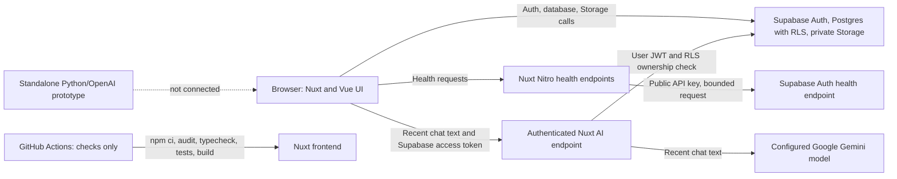

# MaaMaa

MaaMaa is a web application for African event planners, caterers, home cooks, and food vendors. It is intended to help organize catering information and kitchen inventory. The current application supports account access, AI-assisted chat, and inventory management; personalized menus, recipe scaling, and cost estimates are not available yet.

## Current features

- Supabase email/password registration, confirmation, sign-in, sign-out, and password recovery flows.
- Authenticated chat with AI-generated replies through a server-side Google Gemini endpoint. On Google's free tier, submitted text may be used to improve Google products; avoid sending sensitive information.
- Inventory item create, read, update, and delete flows backed by Supabase Postgres.
- JPEG inventory photos in a private Supabase Storage bucket, with short-lived signed URLs.
- An estimator form that collects event inputs and then explains that no estimate is calculated.
- API liveness/readiness endpoints and structured request logs for Nuxt API routes.

The project owner reports manually checking real account sessions, chat persistence, photo upload, and isolation between two accounts. The automated tests do not replace a live RLS or browser test. See [testing strategy](docs/TESTING_STRATEGY.md) and [evidence log](docs/ENGINEERING_EVIDENCE.md) for exact scope.

## Architecture



The Nuxt pages and components own the user interface. Repository modules in `frontend/services/` centralize chat and inventory calls to Supabase. Postgres Row Level Security (RLS) and Storage policies enforce ownership; the browser client is not the authorization boundary by itself. Nitro provides health endpoints and an authenticated `/api/ai/chat` endpoint. The AI route validates the caller's Supabase token, checks chat access using that caller's JWT, bounds conversation input, and keeps the provider key server-side. The Python prototype in `ml/` remains separate and is not called by the frontend.

## Technology

- **Nuxt 3 and Vue 3** provide the page, component, and server runtime.
- **Supabase Auth, Postgres, and Storage** provide identity and user-owned persistence.
- **Pinia** holds frontend auth state; **Tailwind CSS** styles the UI.
- **Node's built-in test runner** exercises validation, repository contracts, AI provider handling, and readiness behavior without adding a test framework.
- **GitHub Actions** is configured to run checks on pull requests and pushes to `main`; it does not deploy.
- **Python and the OpenAI SDK** are used by the optional standalone prototype; the Nuxt server calls the Gemini API over HTTPS.

## Requirements

- Node.js 22 and npm for the frontend workflow (the CI workflow uses Node 22).
- A Supabase project for authenticated data features.
- A server-side Gemini API key for AI chat. Python 3 and an OpenAI API key are needed only for the separate prototype.
- Supabase CLI only when linking a project or managing migrations. The repository root declares it as a development dependency.

## Local setup

Install frontend dependencies and configure the local environment:

```powershell
cd frontend
if (-not (Test-Path .env)) { Copy-Item .env.example .env }
# Edit .env and set the Gemini key below; the model has a default.
npm ci
npm run dev
```

`frontend/.env` must contain:

```dotenv
SUPABASE_URL=https://<project-ref>.supabase.co
SUPABASE_ANON_KEY=<publishable-or-legacy-anon-key>
NUXT_GEMINI_API_KEY=<server-only-gemini-api-key>
NUXT_GEMINI_MODEL=gemini-3.5-flash-lite
```

`SUPABASE_ANON_KEY` is the existing configuration variable name; its value may be the Supabase publishable key or legacy anon key. These are public client keys. `NUXT_GEMINI_API_KEY` and `NUXT_GEMINI_MODEL` are private Nuxt runtime settings. Never prefix the provider key with `NUXT_PUBLIC_` or expose it to client configuration, and never put a Supabase secret/service-role key in the frontend. `.env` is ignored by Git; use `.env.example` as the placeholder template. Add the Gemini settings to local `frontend/.env` and the hosting provider's server environment before expecting AI replies.

For a local certificate trust issue with Node in PowerShell, set the system CA option for that shell before running commands:

```powershell
$env:NODE_USE_SYSTEM_CA = '1'
```

## Database setup and migrations

The tracked schema and RLS policies are in [`supabase/migrations/`](supabase/migrations/). From the repository root, install the Supabase CLI dependency and link only the intended project:

```powershell
npm ci
npx supabase login
npx supabase link --project-ref <project-ref>
npx supabase migration list --linked
npx supabase db push --dry-run
```

Review the linked project, migration history, SQL, and a current recovery point before applying a hosted migration with `npx supabase db push`. Never run `db reset` against a hosted project. Use a separate Supabase project for preview and destructive tests. Details are in [deployment and recovery](DEPLOYMENT.md).

## Quality checks

From `frontend/`:

```powershell
npm ci
npm audit --audit-level=high
npm run typecheck
npm test
npm run build
npm run preview
```

The first GitHub Actions run is still pending. The latest dependency audit found no high or critical advisories in the lockfile, with low and moderate findings remaining; see the evidence log. Some remaining advisories have no fix available in the current dependency ranges. Review any major-version upgrade before applying it.

## Optional ML prototype

The prototype is separate from the Nuxt integration and does not produce estimator results. It sends its example prompts to an external model provider. Its current exception logging, timeout, validation, and automated test coverage are not production-ready.

```powershell
python -m venv .venv
.\.venv\Scripts\Activate.ps1
pip install -r ml/requirements.txt
# For the standalone experiment, create ml/.env with OPENAI_API_KEY=<your-key>.
python ml/prompt_engineer.py
```

See [`ml/README.md`](ml/README.md) for prototype details.

## Deployment and operations

The repository includes a Vercel deployment guide, GitHub CI checks, health endpoints, and an initial recovery procedure. The tracked files do not verify the current Vercel project settings, production environment variables, backup plan, or a restore drill. See [DEPLOYMENT.md](DEPLOYMENT.md) before releasing.

Useful endpoints after deploying:

- `GET /api/health/live` checks that the Nuxt process responds.
- `GET /api/health/ready` checks configuration and Supabase Auth reachability. It does not validate Postgres, Storage, or user-level RLS queries.

## Known limitations

- The estimator form does not calculate menus, ingredient quantities, or prices. Local food prices have not been verified.
- AI chat uses a server-side provider endpoint, but answer quality has not been evaluated and its per-process rate limit is not shared across app instances. The estimator remains disconnected; no quantities or prices are calculated.
- Authenticated user operations call Supabase directly from the browser. RLS and Storage policies are critical security controls.
- Chat creation and its first message are separate database operations, so a partial chat can remain if the message write fails.
- A database backup does not include inventory image objects. The current Supabase backup configuration and a successful restore have not been verified.
- Health readiness checks Auth only; no separate Postgres or Storage health API is configured.
- The current test suite does not run browser automation or live Supabase RLS tests.
- The security audit still reports low and moderate dependency advisories. Some currently have no fix available in the existing dependency tree.

## Troubleshooting

- **Supabase readiness returns 503:** check that `SUPABASE_URL` and `SUPABASE_ANON_KEY` point to the same project and that the Auth endpoint is reachable. The response contains a stable error code and request ID, not credentials or upstream details.
- **Protected pages redirect to login:** confirm the account session and Supabase Auth Site URL/redirect allow-list.
- **Inventory images fail to load:** confirm the private `inventory_images` bucket and owner-folder Storage policies are present, then sign in again to refresh signed URLs.
- **A migration is unexpectedly pending:** inspect `npx supabase migration list --linked`; do not resolve the mismatch with `db reset` on a hosted project.
- **Local build reports a Windows `EPERM` path error:** the build has succeeded in the normal local process; the GitHub Linux CI job is the clean environment check.

## Contributing

See [CONTRIBUTIONS.md](CONTRIBUTIONS.md) for the change and review checklist. Significant architectural decisions are recorded in [`docs/adr/`](docs/adr/). The project evidence log distinguishes automated results from checks reported by the project owner; it does not manufacture commit history or attribute work without evidence.

For an internal portfolio review, see the [readiness assessment](docs/PORTFOLIO_READINESS.md) and the [Software Engineering](docs/narratives/SOFTWARE_ENGINEERING.md) and [Production Engineering](docs/narratives/PRODUCTION_ENGINEERING.md) narrative drafts. The narratives are AI-assisted drafts for the project owner to review and personalize.
